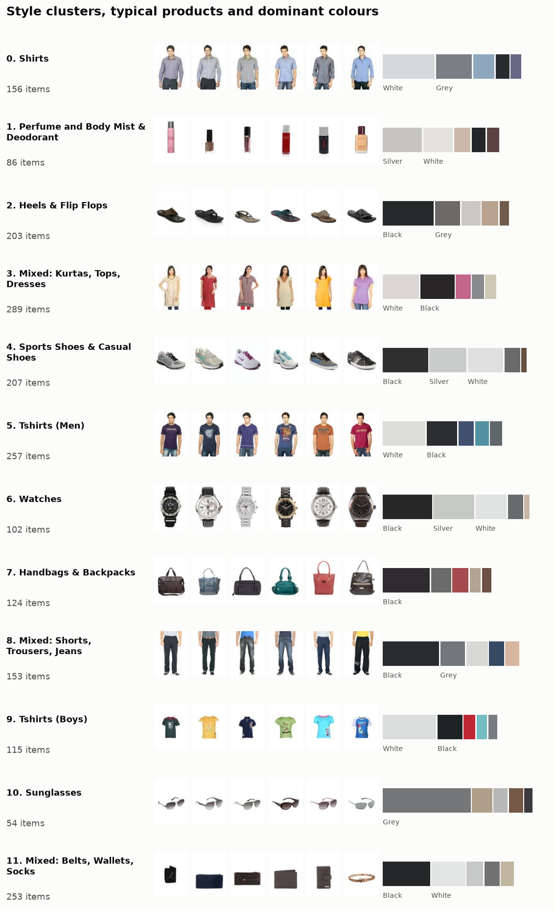
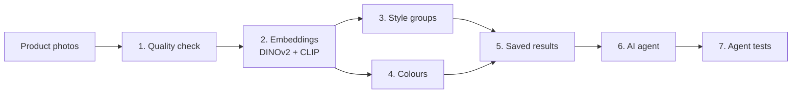
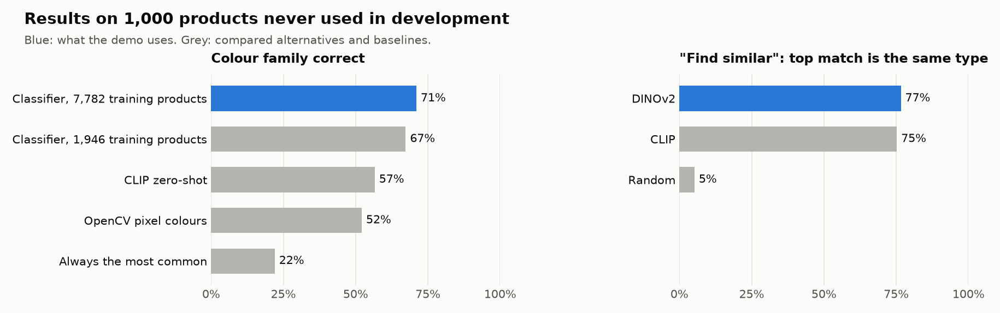
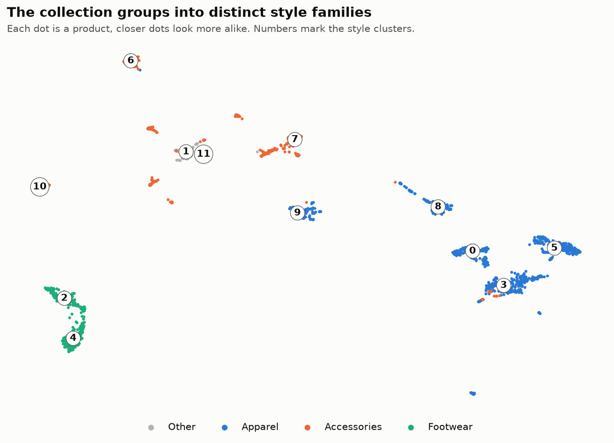

# Visual product catalogue analysis with embeddings and an LLM agent

Turns product photos into **style groups** and **colour palettes**, then answers questions about them in plain English through a **tested AI agent**.



## At a glance

| | Result |
|---|---|
| Style groups found without labels | **12** (9 clear, 3 mixed) |
| "Find similar" returns the same product type | **77%** (random: 5%) |
| Colour family detected correctly | **71%** (always guessing: 22%) |
| Agent test questions passed | **20 / 20** |

All accuracy figures are measured on 1,000 products never used during development. The sample is 1,999 products from a public catalogue of 44,072.

## How it works



| Step | What happens | Result |
|---|---|---|
| **1. Quality check** | Removes blank, unreadable and duplicate images. Checks labels for gaps. | 1 of 2,000 images removed |
| **2. Embeddings** | DINOv2 and CLIP turn each photo into numbers that describe how it looks. | One vector per product |
| **3. Style groups** | k-means groups similar-looking products. UMAP draws the map. | 12 groups |
| **4. Colours** | A classifier predicts the colour family. OpenCV measures the exact shade. | 71% correct |
| **5. Saved results** | Groups, colours and vectors are saved, so the agent looks up answers instead of guessing. | Plain files |
| **6. AI agent** | An LLM picks one of 7 read-only tools and answers from its result. | Plain-English answers |
| **7. Agent tests** | 20 questions, including traps, graded automatically against the data. | 20 / 20 |

Steps 1–5 run with one command. Steps 6–7 need a free Groq key.

## Results





## Findings

- **12 style groups emerge on their own.** Nine are clear (watches, sunglasses, men's T-shirts…). Three are mixed and hold 35% of products.
- **The range is safe and casual.** 78% casual wear, half apparel.
- **Bags are the most colourful.** 72% of bags are not black, white or grey, against 15% of watches and 9% of sports shoes.
- **The catalogue is old.** 71% of products are from 2011–2013, so it says nothing about current trends.

## Agent evaluation

A question passes only if the agent used the right tools, made at most 5 tool calls, and gave an answer matching values computed from the data.

| Category | First run | Second run (×2) | Latest run |
|---|---|---|---|
| Happy path | 7/7 | 14/14 | 7/7 |
| Multi-step | 3/3 | 6/6 | 3/3 |
| Edge cases | 2/5 | 8/10 | 5/5 |
| Out of scope | 3/3 | 6/6 | 3/3 |
| Adversarial | 1/2 | 4/4 | 2/2 |
| **Total** | **16/20** | **38/40** | **20/20** |

What changed between runs:

1. **Crash on a malformed tool call:** fixed with an automatic retry.
2. **Three test bugs:** fixed. Most of the first jump came from fixing the tests, not the agent.
3. **Silent substitution:** asked about "ultraviolet", the agent answered for Purple. Now it asks first, and the grader fails substitutions.
4. **After the colour upgrade:** I re-ran the 8 colour questions, and all 8 passed.

Limits: there are only 20 questions, the same questions guided the fixes, and the latest run asked each question once.

<details>
<summary><b>Technical details</b></summary>

**Dataset.** [`ashraq/fashion-product-images-small`](https://huggingface.co/datasets/ashraq/fashion-product-images-small): 44,072 product images (60×80) with category and colour labels. Labels are used only to score results, and to train the colour classifier.

**Embedding model.** Scored on agreement with product types that clustering never sees. DINOv2 drives grouping and "find similar". CLIP is used for text search.

| 12 clusters | Silhouette | NMI | ARI |
|---|---|---|---|
| DINOv2 | 0.298 | 0.670 | 0.413 |
| CLIP | 0.209 | 0.642 | 0.358 |

**Number of groups.** k = 12 is the smallest k within 5% of the best silhouette score. Silhouette is nearly flat from 12 to 18.

**Colour, in three stages.**

| Stage | Unseen accuracy |
|---|---|
| OpenCV: remove background and skin, k-means in CIELAB | 52.1% |
| Classifier on CLIP + DINOv2 embeddings, 1,946 training products | 67.3% |
| Same classifier, 7,782 training products | **71.0%** |

- **OpenCV fixes:** the first OpenCV version scored 39.8%, because 8-bit LAB overweights lightness. True CIELAB and skin removal fixed most of that.
- **What the classifier is:** logistic regression trained on catalogue colour labels ([colour_classifier.py](src/catalog_vision/colour_classifier.py)). OpenCV is kept for the exact shade.
- **Fair comparison:**
  - Settings were chosen on training data only.
  - 129 training images that were copies of test images were removed.
  - Each sample product is classified by a model that never saw its own label.
- **Diminishing returns:** gains flatten after about 6,000 products. Rare colours improved most (macro F1 0.58 → 0.66).
- **Common mistakes:** grey read as white or black, and blue read as black.

Reports: [colour_method_comparison.json](reports/colour_method_comparison.json), [colour_training.json](reports/colour_training.json).

**"Find similar".** Top-5 matches share the product type 71% of the time with DINOv2 and 70% with CLIP. The difference is not significant. It works best for watches, sunglasses and backpacks, and worst for rare types such as flats and clutches. Most misses are close relatives, such as sports shoes and casual shoes. Details: [similarity_eval.json](reports/similarity_eval.json).

**Data quality.** Details: [data_quality.json](reports/data_quality.json).

| Check | Result |
|---|---|
| Missing key labels | None |
| Repeated product names | 30% |
| Product types with under 10 items | 37 of 141 |
| Image size | 60×80 for 99.9% |
| Sample: unreadable / blank / exact duplicates | 0 / 0 / 1 (removed) |

**Agent failure notes.** Every failing run, with the agent's answer, is in the reports: [first](reports/eval_report_baseline.md), [second](reports/eval_report_final.md), [latest](reports/eval_report_strict.md), [colour re-run](reports/eval_report_colour_classifier.md). A full 20-question run uses about 39,000 tokens.

</details>

## How to run

Python 3.12. The pipeline takes about 3 minutes on an M2 MacBook.

```bash
python -m venv .venv && source .venv/bin/activate
pip install -r requirements.txt

python scripts/run_pipeline.py              # steps 1–5: data, groups, colours, figures
pytest tests                                # unit tests

cp .env.example .env                        # add a free key from console.groq.com
python evals/run_eval.py --label myrun      # steps 6–7: agent tests
```

<details>
<summary>Optional scripts</summary>

```bash
python scripts/train_colour_classifier.py   # train colours on 6,000 more products,
python scripts/run_pipeline.py              #   then rerun the pipeline to use them
python scripts/compare_colour_methods.py --final
python scripts/evaluate_similarity.py
python scripts/plot_results.py              # redraw the results figure
```

</details>

Walkthrough notebook: [notebooks/walkthrough.ipynb](notebooks/walkthrough.ipynb). Only the Groq model `qwen/qwen3.8-27b` has been tested. To use another model, change `AGENT_MODEL` in `.env`.

## Project structure

```
src/catalog_vision/   pipeline code: data, quality, embeddings, clustering, colours, tools, agent
scripts/               pipeline, colour training, evaluations, figures
evals/                 agent test questions and grading
tests/                 unit tests
notebooks/             walkthrough with outputs
reports/               figures, metrics and evaluation reports
```

## Next steps

- Use garment segmentation and larger images for better colours. More of the same training data no longer helps.
- Test the colour model on another catalogue's photos.
- Split the mixed groups with a second clustering pass.
- Add unseen agent test questions, and repeat each one several times.
- Join sales and recent trend data.

## Data note

The images come from a public Hugging Face dataset whose card states no licence. Thumbnails are shown for demonstration only, and the dataset is not included in this repository.
